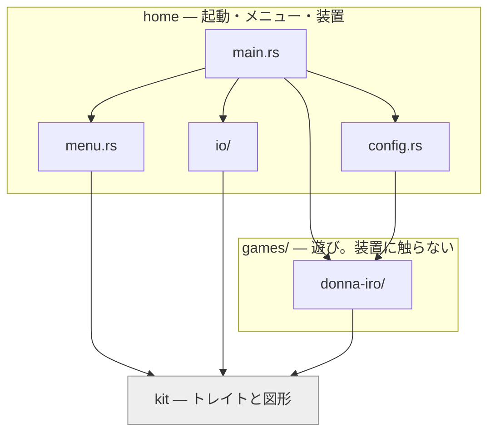

# donna-iro

テレビの前で遊ぶ、2歳児向けの声の遊びを並べたもの。起動するとメニューが出て、
遊ぶものをリモコンで選ぶ。

| 遊び | 名前（`--game`） | 中身 |
| --- | --- | --- |
| [どんないろがすき？](games/donna-iro/README.md) | `donna-iro` | 呼びかけに子どもが色名を叫ぶと、その色の続きを歌う。テレビに色を映しながら鳴らす |

> [!NOTE]
> **`donna-iro` は2つのものを指す。** このリポジトリ全体（実行ファイル名・
> 環境変数の接頭辞 `DONNA_IRO_`・配布先 `~/donna-iro`）と、遊びの1つ
> （`games/donna-iro/`）。この README で単に donna-iro と書くときは前者。

## ドキュメントの地図

| 読みたいこと | 場所 |
| --- | --- |
| 動かす・設定する・配る | この README |
| 遊びを作る・足す | [`games/README.md`](games/README.md) |
| どんないろがすき？の進行と判定 | [`games/donna-iro/README.md`](games/donna-iro/README.md) |
| どんないろがすき？の音源の作り方 | `games/donna-iro/assets/README.md`（private サブモジュール） |
| 装置（マイク・whisper・画面・リモコン）の作り | [`home/README.md`](home/README.md) |
| ラズパイとテレビ | [`pi/README.md`](pi/README.md) |
| 画面に出す字のフォント | [`home/fonts/README.md`](home/fonts/README.md) |

## 遊び方

```
メニュー ──決定──→ 遊ぶ ──終わる / 戻る──→ もう1回？
   ↑                 ↑                       │
   │                 └───────決定────────────┤
   └─────────────────────戻る────────────────┘
```

| 操作 | リモコン | キーボード | マウス | ターミナル（`--terminal`） |
| --- | --- | --- | --- | --- |
| 選ぶ | 十字キー | 矢印 / 数字 | 札を押す | 数字 |
| 決定・もう1回 | 決定 | Enter / Space | 左クリック（「もう1回」はどこでも） | Enter |
| 戻る | 戻る | Backspace | 右クリック | `b` |
| 終わる | — | Esc | ウィンドウを閉じる | Ctrl-D |

「戻る」の行き先は、いる場所で決まる。

| いる場所 | 「戻る」で |
| --- | --- |
| 遊びの途中 | 歌を止めて「もう1回」の画面へ |
| 「もう1回」の画面 | メニューへ |

> [!IMPORTANT]
> **遊んでいる最中の十字キーと決定では何も起きない。** 押し間違いで歌を切らない。

> [!NOTE]
> 「戻る」が効くまでの遅れは場面で違う。
>
> | 押したとき | 効くまで |
> | --- | --- |
> | 歌の途中 | すぐ |
> | 子どもの答えを聞き取っている最中 | 聞き取りの窓が閉じてから（最大 `listen.max_seconds`） |
> | ターミナル構成 | 歌っている間は入力を読まない。途中でやめるなら Ctrl-C |

## 準備

```sh
git clone --recurse-submodules git@github.com:mpyw/donna-iro.git
cd donna-iro
mise install                              # cmake と git-lfs（mise.toml）
git -C games/donna-iro/assets lfs pull    # 音源を取る
tools/fetch-model.sh                      # whisper のモデルを取る（base・141MB）
cargo build --release
./target/release/donna-iro
```

> [!WARNING]
> **`mise.toml` に載るのは cmake と git-lfs だけ。** whisper.cpp のビルドには
> libclang（`bindgen` が使う）も要る。ラズパイでは ALSA の開発ヘッダも要る。
> どちらも OS の側から来るので、mise では宣言できない。
> 足りないものは `tools/check.sh` が冒頭で名前を出して止める。

> [!TIP]
> clone 済みでサブモジュールが空なら `git submodule update --init` を打つ。
> `git config submodule.recurse true` にしておくと、pull のたびに追従する。

素材の在処と、本番音源が無いときの振る舞いは
[`games/README.md`](games/README.md#素材) にある。

## 動かす

| 引数 | |
| --- | --- |
| `--terminal` | ウィンドウを使わず文字だけ出す |
| `--keyboard` | マイクの代わりに手打ち |
| `--game <name>` | メニューを飛ばしてその遊びから始める（例: `donna-iro`） |
| `--once` | 1回遊んだら終わる。「もう1回」もメニューも出さない |
| `--config <path>` | 別の設定ファイルを読む（既定はカレントの `config.toml`） |
| `--help` | 使い方 |

次の場合はエラーで止まる。**指定したのに効いていない、が一番たちが悪い。**

- 知らない引数
- 値の無い `--config` / `--game`
- 知らない遊びの名前
- `--config` に指定したファイルが無い

### 設定

つまみは全部 `config.toml` にある。全項目にコメントと、対応する環境変数名が
書いてある。何をいじれるかはそのファイルを見ること。

| 節 | 中身 |
| --- | --- |
| `[paths]` | 遊びの根と whisper のモデルの在処 |
| `[listen]` | マイク。応答を待つ長さ、発話とみなす音量 |
| `[recognize]` | whisper。エンコーダの文脈長 |
| `[games.<name>]` | 遊びごとのつまみ。節の名前は遊びの名前の `-` を `_` にしたもの |

値は3段で決まる。後のものが前を上書きする。

1. コード上の既定値
2. `config.toml`
3. 環境変数

**環境変数の名前はキーの位置から機械的に決まる。** 接頭辞は `DONNA_IRO_`、
節とキーの区切りは `__`（2本）。キー名自体に `_` が入るので、節の区切りは
別の記号にしてある。環境変数に `-` は使えないので、遊びの節も `_` で書く。

```sh
DONNA_IRO_RECOGNIZE__AUDIO_CTX=512 cargo run                # recognize.audio_ctx
DONNA_IRO_LISTEN__THRESHOLD=0.02 cargo run                  # listen.threshold
DONNA_IRO_PATHS__MODEL=models/ggml-tiny.bin cargo run       # paths.model
DONNA_IRO_GAMES__DONNA_IRO__INSERT_EVERY=2 cargo run        # games.donna_iro.insert_every
```

## ビルドの切り替え

| フィーチャー | |
| --- | --- |
| `whisper` | 音声認識（既定）。外すとキーボード入力のみ。ビルドが数十秒で済む |
| `window` | ウィンドウ描画（既定）。外すとターミナルに文字だけ。文字描画（`fontdue`）も付いてくる |
| `embed-audio` | 音源をバイナリに埋め込む。全部の遊びの本番音源が揃っている必要がある |
| `embed-reference` | 本番音源の代わりに確認用の合成音を埋め込む |
| `embed-model` | whisper のモデル（base・141MB）も埋め込む |
| `embed` | `embed-audio` と `embed-model`。**バイナリ1つで完結する。** 合成音で組んだ `.app` で 157MB（モデルが 141MB） |
| `coreml` | Apple 専用。Metal は macOS で**既定有効**なので指定不要 |
| `openblas` / `openmp` | ラズパイ側の加速。素でも NEON は使うので、まず無指定で測る |

> [!WARNING]
> **実行時の合成音へのフォールバックは、埋め込みには効かない。**
> `include_bytes!` はファイルの有無を見られないため。本番音源が無い状態で
> 埋め込むなら `embed-reference` を選ぶ。

## 配る

| 先 | コマンド | 詳しく |
| --- | --- | --- |
| macOS の `.app` | `tools/bundle-mac.sh` → `target/donna-iro.app` | 下 |
| ラズパイ | `tools/build-pi.sh`（組むだけ）/ `tools/build-pi.sh pi5`（ssh 先へ配る） | [`pi/README.md`](pi/README.md) |

### macOS の .app

- **Metal が効くので、認識が CPU より速い。**
- **音源とモデルは埋め込む。** `.app` は CWD が `/` になるので、相対パスでは読めない。
- **本番音源が無ければ合成音で組む。** スクリプトが見て `embed-reference` に切り替える。
- `Info.plist` にマイクの用途を書いてある。初回に許可を聞かれる。

合成音を `assets/` へコピーして本番扱いにする手もある。ただ、あそこは
private サブモジュールなので汚したくない。

## 構成

**ワークスペースを3層に分けてある。**

| クレート | 中身 | 読んでよいもの | 詳しく |
| --- | --- | --- | --- |
| `home/` | 起動、メニュー、装置、設定の読み込み | `kit` と全部の遊び | [`home/README.md`](home/README.md) |
| `kit/` | 遊びと装置の継ぎ目。トレイトと、描く図形だけ | 何も読まない | [`games/README.md`](games/README.md#kit--遊びが知ってよいもの) |
| `games/<name>/` | 遊びそのもの。**装置にもファイルにも触らない** | `kit` だけ | [`games/README.md`](games/README.md) |



> [!IMPORTANT]
> **遊びから `home` を読んではいけない。** `home` はメニューに並べるために
> 遊びを読むので、逆を許すと循環する。依存の向きは Cargo が見張っている。
> 遊びが装置に手を伸ばすとビルドが通らない。

## 開発

```sh
tools/check.sh
```

全 feature の組み合わせでコンパイル・テスト・書式を確かめる。
**既定のビルドだけ見て通ったと思わないこと。** feature を削った構成は静かに壊れる。

`use` の粒度と並びは `rustfmt.toml` で決めている。ただし**この設定は nightly
でしか効かない。** 安定版の `cargo fmt` は警告を出して素通りするだけで、整形
そのものは壊れない。`tools/check.sh` は nightly が入っていればそちらで見る。
手で揃えるときは:

```sh
rustup toolchain install nightly --profile minimal --component rustfmt
RUSTFMT="$(rustup which --toolchain nightly rustfmt)" cargo fmt
```

### ツール

| | |
| --- | --- |
| `tools/check.sh` | 全 feature の組み合わせでコンパイル・テスト・書式と、ビルドに要る OS 側の道具を確かめる |
| `tools/fetch-model.sh` | whisper のモデルを `models/` に取る（既定 base、`tiny` なども可） |
| `tools/bundle-mac.sh` | macOS の `.app` を作る（Metal + 埋め込み） |
| `tools/build-pi.sh` | ラズパイ向けに組んで配る（arm64 コンテナでネイティブに） |
| `tools/cec-probe.sh` | テレビのリモコンが何をどう届けるかを見る（ラズパイをテレビに繋いでから） |
| `tools/split_score.py` | どんないろがすき？専用。元譜面から素材ごとの MusicXML を切り出す |
| `tools/render_reference.py` | どんないろがすき？専用。MusicXML から確認用の合成音を書き出す |

## whisper のモデル

モデルはリポジトリに置かない。`tools/fetch-model.sh` で `models/` に取る。
既定は base。速さを詰める話は [`home/README.md`](home/README.md#音声認識) にある。
